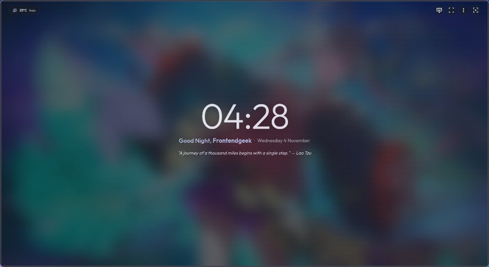
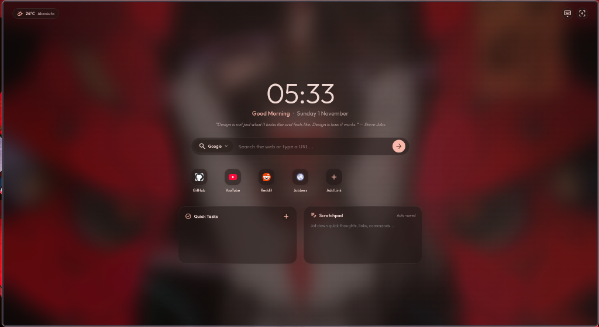
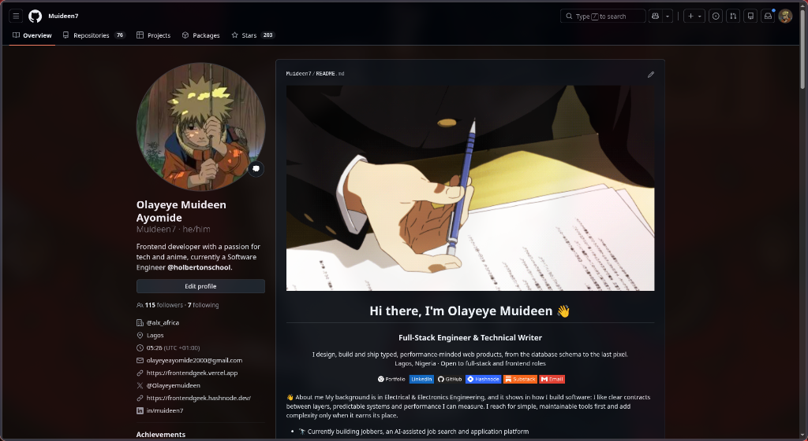

<div align="center">

# 🌌 Caelestia Dynamic New Tab
### A Keyboard-First Material Design 3 New Tab & Dynamic Site Themer for Chromium on Wayland / Hyprland

[](#)
[](#)
[](#)
[](#)

<p align="center">
  A keyboard-centric, distraction-free dashboard that synchronizes with your Linux desktop's active wallpaper palette in real time, respects window tiling, and styles websites like YouTube and GitHub with 0% CPU overhead.
</p>

</div>

---

## 📸 Screenshots

### 1. Zen / Focus Mode (Default View on Every New Tab)
> Every new tab opens by default in clean Zen mode with a large readable clock, contextual greeting, prominent daily quote, and frosted desktop wallpaper. Press <kbd>S</kbd> or <kbd>/</kbd> anytime to summon search.



---

### 2. Standard Mode (<kbd>Z</kbd>)
> Toggle the full dashboard view with <kbd>Z</kbd> to access quick shortcuts, tasks checklist, and an auto-saving scratchpad.



---

### 3. Dynamic Website Theming & Hidden Address Bar
> Applies your desktop wallpaper's Material You palette directly to websites (like GitHub and YouTube) in both Light and Dark mode while keeping the window tiled properly in Hyprland with the address bar hidden.



---

## ✨ Features

- **🧘 Keyboard-First Zen Mode by Default**: Every new tab opens in a peaceful, distraction-free Zen state. No mouse interaction needed—keyboard focus is instantly asserted.
- **🔍 Quick Search Pop-over (<kbd>S</kbd> or <kbd>/</kbd>)**: Tap <kbd>S</kbd> or <kbd>/</kbd> anywhere on the page to instantly pop up the search bar, type your query or URL, and press <kbd>Enter</kbd>. Press <kbd>Esc</kbd> to return to clean Zen mode.
- **⚡ Visual Navigation Loading States**:
  - **Top Material 3 Linear Progress Bar**: A sleek glowing progress line glides across the top edge as soon as a search query, link, or menu action is submitted.
  - **Search Button Spinner**: The submit arrow morphs into an indeterminate spinner (`progress_activity`).
  - **Navigation Status Toast**: A bottom-centered glassmorphic pill confirms target destination in real time (e.g. `Opening YouTube...`, `Opening Settings...`).
- **📖 Prominent & Legible Daily Quotes**: Inspiring, hand-curated quotes displayed in prominent, comfortable typography below the clock—no eye squinting required.
- **🚀 3-Step Interactive Onboarding Wizard**: Automatically greets first-time users upon installation from the Chrome Web Store. Guides users through features, lets them set their display name, choose default startup mode (Zen vs Full Dashboard), and presents a quick shortcuts tour.
- **⚙️ Extension Preferences Page (`options.html`)**: Clean Material 3 preferences tab to configure user display name, default startup view, search engine preference, hints bar visibility, or re-run the welcome tour anytime.
- **🛡️ Search Mode Keyboard Shield**: When search mode is activated via <kbd>S</kbd>, all typing is safely trapped and routed directly into the search bar—letters like <kbd>H</kbd> (history) or <kbd>D</kbd> (downloads) never accidentally navigate away.
- **⚙️ Browser Quick Menu (<kbd>P</kbd>) & Settings (<kbd>,</kbd>)**:
  - Press <kbd>P</kbd> to open the Browser Quick Menu with one-key navigation:
    - <kbd>H</kbd> → History (`chrome://history`)
    - <kbd>D</kbd> → Downloads (`chrome://downloads`)
    - <kbd>B</kbd> → Bookmarks (`chrome://bookmarks`)
    - <kbd>E</kbd> → Extensions (`chrome://extensions`)
    - <kbd>S</kbd> → Browser Settings (`chrome://settings`)
    - <kbd>O</kbd> / <kbd>,</kbd> → Caelestia Preferences (`options.html`)
  - Press <kbd>,</kbd> or <kbd>Ctrl</kbd> + <kbd>,</kbd> to jump straight into Extension Preferences.
- **🎨 Live Material You Color Parity**: Automatically adapts to dynamic color schemes generated from your wallpaper (`~/.local/state/caelestia/scheme.json`), seamlessly transitioning between light and dark modes with **WCAG AAA high contrast readability**.
- **🪟 Tiling-First Window Management**: Never breaks your window manager's tiling tree. Open apps side-by-side (e.g. Brave next to Foot or Kitty terminal) with proper resizing, gaps, and borders.
- **⌨️ Toggleable Navigation Hints Bar (<kbd>K</kbd> / <kbd>?</kbd>)**: Built-in reference for tab navigation. Toggle on/off with <kbd>K</kbd>.
- **🌤️ Local Weather Pill**: Real-time temperature, condition icon, and city name powered by the Open-Meteo API.
- **⚡ Lightweight Site Theming**: Declarative CSS overrides for **YouTube**, **GitHub**, **Reddit**, and **Wikipedia** that eliminate harsh pitch-black/pure-white contrast in favor of your dynamic palette—with **0% CPU/GPU overhead** (no continuous `MutationObserver` loops).
- **📝 Productivity Cards**:
  - **Quick Tasks**: Daily checklist with completion status saved locally.
  - **Scratchpad**: Auto-saving scratchpad for quick notes, links, and commands.

---

## ⌨️ Complete Keyboard Shortcuts Reference

| Shortcut | Action | Scope |
| :--- | :--- | :--- |
| <kbd>S</kbd> or <kbd>/</kbd> | **Summon Quick Search** (instantly type a query or URL, <kbd>Enter</kbd> to go) | Dashboard |
| <kbd>Esc</kbd> | **Dismiss Search or Close Active Menus/Modals** | Everywhere |
| <kbd>P</kbd> | **Open Browser Quick Menu** (History, Downloads, Bookmarks, Extensions, Preferences) | Dashboard |
| <kbd>,</kbd> or <kbd>Ctrl</kbd> + <kbd>,</kbd> | **Open Caelestia Preferences** (`options.html`) | Dashboard |
| <kbd>Z</kbd> | **Toggle Full Dashboard / Zen Mode** (reveal shortcuts, tasks, and scratchpad) | Dashboard |
| <kbd>K</kbd> / <kbd>?</kbd> | **Toggle Navigation Hints Bar** (shows/hides the top-right shortcut pills) | Dashboard |
| <kbd>H</kbd> | Direct jump to **History** (`chrome://history`) | Dashboard / Menu |
| <kbd>D</kbd> | Direct jump to **Downloads** (`chrome://downloads`) | Dashboard / Menu |
| <kbd>B</kbd> | Direct jump to **Bookmarks** (`chrome://bookmarks`) | Dashboard / Menu |
| <kbd>E</kbd> | Direct jump to **Extensions** (`chrome://extensions`) | Dashboard / Menu |
| <kbd>O</kbd> / <kbd>,</kbd> | Jump to **Caelestia Preferences** (`options.html`) | While Menu is open |
| <kbd>S</kbd> | Jump to **Browser Settings** (`chrome://settings`) | While Menu is open |

---

## 🌐 Browser Compatibility

Built with standard **Chromium Manifest V3** and 100% compatible with:
- **Brave**
- **Google Chrome**
- **Microsoft Edge**
- **Vivaldi**
- **Chromium / Thorium / CachyOS Browser**
- **Ungoogled Chromium**

---

## 🪟 Hyprland Integration (Hide Address Bar in Tiled Mode)

To achieve the clean, address-bar-free appearance while keeping the window tiled properly alongside your terminal:

### In Caelestia Shell (`~/.config/caelestia/hypr-user.lua`):
```lua
hl.window_rule({ match = { class = "brave-browser" }, fullscreen_state = "0 2" })
```

### In Vanilla Hyprland (`~/.config/hypr/hyprland.conf`):
```ini
windowrulev2 = fullscreenstate 0 2, class:^(brave-browser)$
```

> **How it works:**
> - `internal: 0` instructs Hyprland to treat the window as a normal tiled window (respecting gaps, borders, and window resizing).
> - `client: 2` tells the browser it is in fullscreen, causing it to hide the address bar and omnibox header completely.

---

## 📄 License

MIT License. Designed with ❤️ for clean desktop aesthetics.
