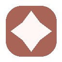
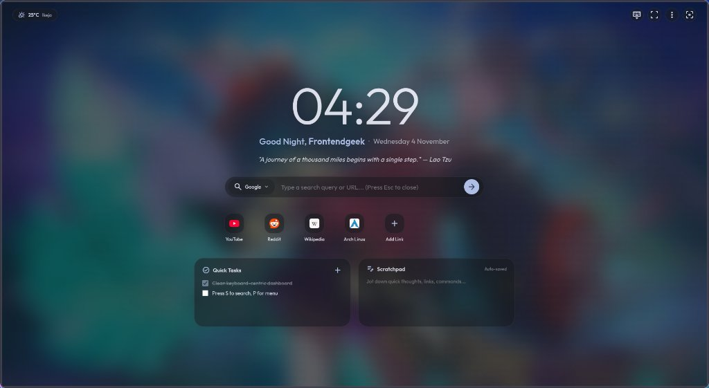
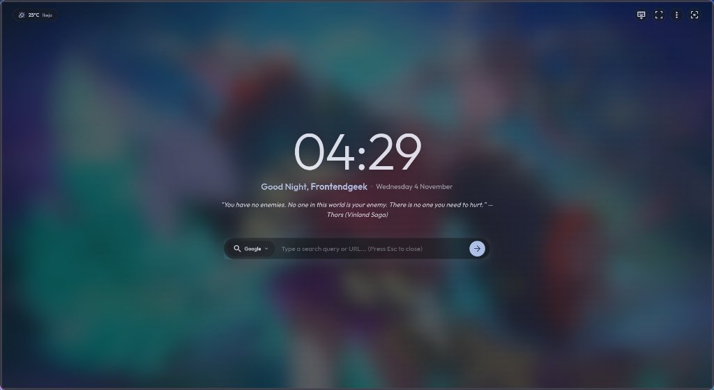

<h1 align="center">


<br>
Caelestia-DNT

</h1>

<p align="center">
Material You new tab & site themer that syncs with your Linux wallpaper palette.
</p>

<p align="center">
<a href="#screenshots"><strong>Screenshots</strong></a> · <a href="#install"><strong>Install</strong></a> · <a href="#keyboard-shortcuts"><strong>Keys</strong></a> · <a href="#site-theming"><strong>Site Theming</strong></a> · <a href="#fullscreen-strategies"><strong>Fullscreen</strong></a> · <a href="#privacy"><strong>Privacy</strong></a>
</p>


---

## What It Does

- Reads your desktop's Material You palette (from Noctalia, Caelestia, GNOME, KDE, Sway, XFCE, matugen, pywal, or wallust) and themes both the new tab and supported websites.
- New tab has Zen mode (clock + quote), a dashboard (shortcuts, tasks, scratchpad), and a quick search overlay.
- Injects your palette into **YouTube**, **GitHub**, **Google Search**, **Reddit**, and **Wikipedia** — readable, accessible, no layout breakage.
- Tiling-aware fullscreen that respects your gaps, bars, and columns instead of hijacking the monitor.

---

## Screenshots

### 1. Zen Mode (<kbd>Z</kbd>)
Minimalist distraction-free clock, greeting, and quotes over your dynamic wallpaper.


### 2. Dashboard Mode (Zen Mode Off)
Full productivity dashboard with quick shortcuts, daily task checklist, and auto-saving scratchpad.



### 3. Quick Search Overlay (<kbd>S</kbd> or <kbd>/</kbd>)
Instant floating search with engine switcher (Google, Brave, DuckDuckGo, YouTube, Wikipedia).



---

## Install

### 1. Clone

```bash
git clone https://github.com/Muideen7/Caelestia-DNT.git
cd Caelestia-DNT
```

### 2. Load the Extension

Open `chrome://extensions` (or `brave://extensions`, `thorium://extensions`), enable **Developer mode**, click **Load unpacked**, select the cloned folder.

### 3. Connect Your Desktop Colors

**Pick one:**

| Method | Command | Notes |
|--------|---------|-------|
| Native messaging (recommended) | `./install-native-host.sh` | Zero open ports. Auto-detects all installed Chromium browsers. |
| Bridge daemon | `python3 caelestia-bridge.py` | Serves palette on `127.0.0.1:39123`. Good for packed/store installs. |

Both auto-detect your DE/WM and wallpaper tool. No config needed.

### Noctalia (Niri) Users

If you use Noctalia, the install script above handles everything. Noctalia's template engine writes `noctalia-theme.json` and `noctalia-wallpaper.jpg` directly into the extension folder on every palette change.

Optional: load `~/.cache/noctalia-dnt/thorium-theme` as a second unpacked extension to also theme the browser frame and tab strip.

### Caelestia (Hyprland) Users

Register post-hooks in `~/.config/caelestia/cli.json`:

```json
{
  "theme": {
    "postHook": "cp -f \"$HOME/.local/state/caelestia/scheme.json\" \"<extension-dir>/caelestia-theme.json\""
  },
  "wallpaper": {
    "postHook": "cp -f \"$HOME/.local/state/caelestia/scheme.json\" \"<extension-dir>/caelestia-theme.json\""
  }
}
```

---

## Keyboard Shortcuts

| Key | Action |
| :---: | :--- |
| <kbd>Z</kbd> | Toggle Zen / Dashboard mode |
| <kbd>F</kbd> / <kbd>F11</kbd> | Toggle fullscreen (tiling-immersive or native) |
| <kbd>S</kbd> / <kbd>/</kbd> | Open search overlay |
| <kbd>P</kbd> | Browser quick menu (tabs, history, downloads, bookmarks, extensions, settings) |
| <kbd>,</kbd> | Open preferences |
| <kbd>H</kbd> | History |
| <kbd>D</kbd> | Downloads |
| <kbd>B</kbd> | Bookmarks |
| <kbd>E</kbd> | Extensions |
| <kbd>C</kbd> | Copy current quote |
| <kbd>R</kbd> | Random new quote |
| <kbd>K</kbd> | Toggle hints bar |
| <kbd>?</kbd> | Reopen onboarding tour |
| <kbd>Esc</kbd> | Close overlays / dismiss |

---

## Site Theming

The content script injects your wallpaper palette into these sites:

| Site | What's themed |
|------|--------------|
| YouTube | Backgrounds, search bar, sidebar, chips, buttons, menus |
| GitHub | Primer tokens, header, file tree icons, PR/issue status colors, markdown |
| Google Search | Results, knowledge panel, People Also Ask, chips, pagination, autocomplete |
| Reddit | Post cards, header, content text |
| Wikipedia | Body, navigation, links |

All other sites get a universal theme (CSS variables for Tailwind/Radix/Bootstrap, scrollbars, selection, forms, buttons).

Contrast ratios follow WCAG AA (4.5:1 body text, 3:1 large text).

---

## Fullscreen Strategies

Configurable in Preferences:

| Strategy | Behavior |
|----------|----------|
| **Tiling Immersive** (default) | Fullscreen inside your current tile/column. Respects gaps, bars, and splits. |
| **Native Display** | Standard F11 OS fullscreen across the monitor. |
| **Tab Fullscreen** | Browser Fullscreen API (HTML5). |

The extension also auto-adapts layout when resized: compact (<700px), split (700–1150px), wide, ultra-wide (>1800px), and single-app/monocle detection.

---

## Privacy

- No analytics, no telemetry, no tracking.
- All data (tasks, notes, preferences) stored locally in `chrome.storage.local`.
- Optional network requests: Open-Meteo + ipapi.co (weather), Quotable/DummyJSON (quotes), Google Fonts (typography), Google favicon service (shortcut icons). Block at network level for fully offline use.
- Bridge daemon binds to `127.0.0.1` only.

---

## License

MIT — see [LICENSE](./LICENSE).
